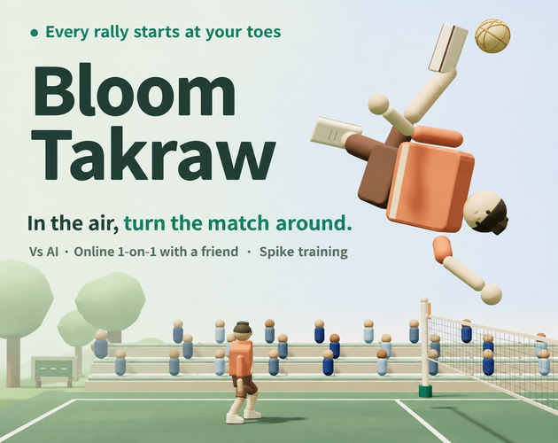

# itch.io 웹 제출용 zip(v0.15.2~)

itch.io 게임잼에 HTML5(브라우저 플레이)로 낼 때 올리는 zip은 `npm run build:itch`로 만든다. Pages·`npm run dev`가 쓰는 원본은 그대로 두고, zip만 따로 만든 산출물이다(D-176).

```text
npm run build:itch
→ dist/itch/                          압축 전 폴더(확인용)
→ dist/bloom-takraw-itch-<버전>.zip     itch에 올리는 파일
```

## 빌드가 하는 일

`scripts/build-itch.mjs`가 순서대로 처리한다.

1. 실행에 필요한 원본만 그대로 복사한다: `index.html`, `manifest.webmanifest`, `sw.js`, `src/`, `styles/`, `assets/`, `pwa/`. 문서·시험·스크립트는 넣지 않는다.
2. `index.html` import map의 CDN 주소(three·rapier·gamekit)를 내려받아 `vendor/` 아래에 같은 경로로 둔다. 받은 파일이 상대 경로로 부르는 파일(three의 `three.core.js`)도 따라 받는다. gamekit 모듈은 `gamekit.lock.json`의 sha256과 맞지 않으면 멈춘다.
3. zip 안의 `index.html`만 import map 주소를 `./vendor/…`로 바꾼다. 소스 코드는 고치지 않는다.
4. 외부 압축 도구 없이 node만으로 zip을 만든다. 압축 루트에 `index.html`이 바로 있다. itch 한도(파일 1,000개, 압축 전 500MB, 경로 240자)를 넘으면 멈춘다.

v0.16.0 기준 결과는 파일 69개(vendor 18개 포함), 압축 전 8.65MB, zip 3.13MB다.

## itch 안에서 달라지는 것

- **서비스워커(PWA):** 다른 페이지의 iframe 안이면 등록하지 않는다(`src/runtime.js`의 `embedded`). itch에서는 설치할 수 없고, 같은 출처를 쓰는 다른 게임과 캐시가 섞일 수 있어서다. 공개 Pages 주소에서는 그대로 설치할 수 있다.
- **주소 파라미터:** itch 페이지 주소의 `?lang=`, `?debug`는 iframe으로 넘어가지 않는다. 언어는 설정 창의 언어 줄에서 바꾼다.
- **저장:** 팀·설정은 그 iframe 출처에 저장된다. 브라우저가 itch 페이지 기준으로 따로 나눠 저장하므로, Pages에서 만든 팀과 이어지지 않는다.

## 게임 커버

itch.io 게임 커버는 [itch-cover.png](images/itch-cover.png)를 사용한다. 크기는 **630 × 500px**, 비율은 **63:50**이며 제목·스파이크 캐릭터와 코트 배경을 함께 담는다.



이미지는 저장소에 보관하며 itch.io 업로드와 Save는 사용자가 직접 한다. 게임 실행 파일과 커버 교체는 별개다.

## itch 페이지 설정

- Kind of project: HTML, 업로드한 zip에 "This file will be played in the browser" 체크
- Viewport: 960 × 540 이상. 이 크기에서 처음 화면·경기·온라인 대전이 스크롤 없이 들어간다.
- Fullscreen button 켜기
- Mobile friendly 켜기, Orientation은 Landscape(세로 화면이면 게임이 돌리라고 안내한다)
- Click to launch in fullscreen은 끄기, SharedArrayBuffer 지원은 필요 없음
- 첫 클릭 전에는 키 입력이 iframe에 들어가지 않는다. 처음 화면이 버튼 클릭으로 시작하므로 따로 할 일은 없다.

## 확인한 것(v0.15.2, 이 PC의 Chromium)

zip을 풀어 `127.0.0.1:8811`에 두고, 다른 출처 페이지(`localhost:8812`)의 960×540 iframe으로 열었다. jsDelivr 요청은 모두 막았다.

- 부팅 완료, CDN 요청 0건, 실패 요청 0건, 페이지 오류 0건
- 서비스워커 등록 0개
- 첫 클릭 뒤 키보드로 선수 이동, 스페이스로 바깥 페이지가 스크롤되지 않음
- 배경 음악 재생, 팀 이름이 새로고침 뒤에도 남음
- 방 코드 복사("Copied" 표시), 두 브라우저 온라인 1대1 연결(실제 Nostr/WebRTC, 해시 불일치 0)

실제 itch.io 페이지(`html-classic.itch.zone`)와 실물 휴대폰에서는 아직 확인하지 않았다. 잼 규칙(마감 뒤 빌드 수정, 외부 리소스 허용)은 잼마다 다르니 참가할 잼에서 직접 확인한다.
