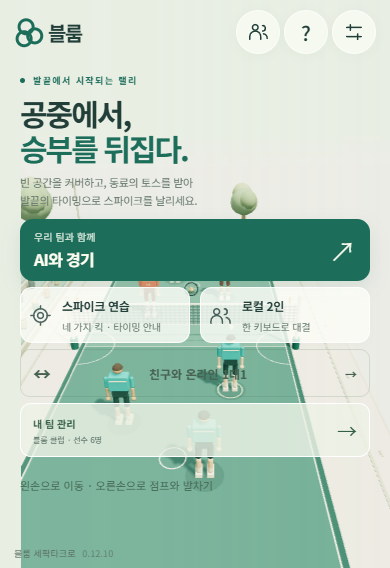
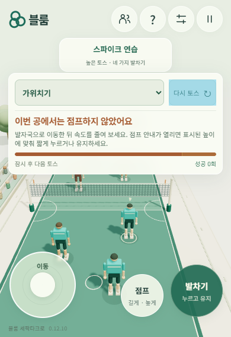
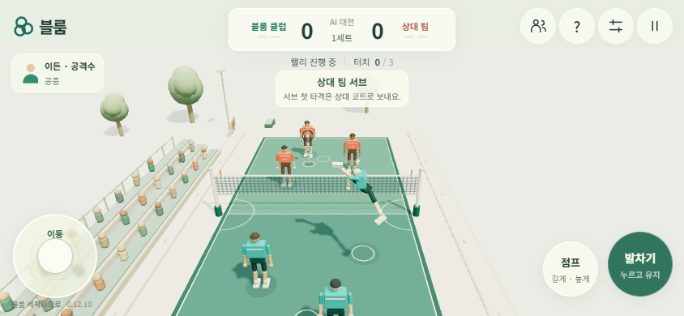

# 모바일 조작과 연습 토스

2026-10-26, v0.12.10 Candidate. 기준 main은 `5127f84bb45756dda0cc69d91deaddbcdb7cdbaa`다. 호환되는 터치 UX 개선과 연습 버그 수정이므로 공통 버전 규칙에 따라 PATCH를 올렸다.

## 모바일 화면과 입력

왼쪽 이동 패드와 오른쪽 점프·킥을 크게 배치했다. 세로 화면은 이동 패드 112px, 점프 72px, 킥 88px이며 가로는 104px·68px·80px다. 메뉴·연습 선택·다시 토스는 44px 이상의 터치 영역을 유지한다. 화면 안전 영역과 동적 높이를 반영하고, 390×844·390×568·844×390·568×390에서 홈·경기·연습 배치를 직접 확인했다.

훈련 안내는 선택·재시도·현재 동작·타이밍을 중심으로 줄여 코트를 덜 가린다. 홈·도움말·경기·연습 안내는 터치 조작 이름을 사용한다. 중복 생성되던 연습 선택지도 정의에서 한 번만 만든다.

스틱의 실제 크기와 손잡이 크기로 이동 범위를 계산하고 원형 데드존으로 작은 흔들림을 줄인다. 동시에 누른 손가락 중 하나만 떼어도 남아 있는 입력의 표시를 유지한다. 이동 패드를 누른 상태에서 다른 손가락으로 메뉴를 열 수 있도록 보조 터치도 처리한다. 메뉴·회전·크기 변경·앱 전환에서는 입력과 포인터 캡처를 해제한다.

## 연습에서 상대편으로 토스하던 원인

세터의 목표는 원래 아군 공격수였다. 하지만 연습 시작 공의 전방 간격 0.65m가 현재 수신 간격보다 좁아 발보다 정강이에 먼저 닿았다. 정강이 충돌의 반동으로 공이 상대 코트로 넘어갔다. `training.feed.offset`만 **0.65 → 0.8**로 맞췄다. 일반 경기·발 구동·공의 힘은 수정하지 않았다.

실제 Chromium/Rapier의 같은 기본 능력치·무입력 연습을 비교했다. 진단용 인스턴스의 자연 반복 결과이며 제품 UI 결과와 구별한다.

| 시작 간격 | 접촉 | 상대편으로 넘어간 토스 |
| --- | --- | ---: |
| 기존 0.65m | 정강이 10/10 | 10/10 |
| 수정 0.8m | 발 10/10 | 0/10 |

별도 실제 UI의 자연 반복 5회도 모두 발로 아군 쪽에 올렸고 공격 타이밍 가이드가 생성됐다. [training-comparison.json](mobile-training/training-comparison.json)에 목표·접촉·속도·궤적 관찰을 보존했다. 직접 조작 프로브의 마지막 네트 통과는 머리 접촉이었으므로 스파이크 성공으로 집계하지 않는다.

## 고정 사용자 흐름

`tests/mobile-flow.spec.js`는 CDP의 실제 터치 이벤트를 보내 홈 시작 → 이동·점프·킥 동시 입력 → 일부 해제·취소 → 이동 중 메뉴 → 가로 회전 → 연습 선택·자연 반복 3회 → 다시 토스 → 짧은 세로 화면 → 도움말·퇴장을 확인한다. 스틱 입력, 선수의 실제 이동·점프, 눌림 해제, 버튼의 화면 내 배치·44px 영역·상호 비중첩을 확인한다. 연습은 세터의 발 접촉·확정 세트·최고점 3.3m 이상·플레이어 무입력 상태에서 상대편으로 넘어가지 않음을 시도 종료까지 관찰한다.

기존 두 브라우저 사용자 흐름도 유지한다. 기본 서브 수신 10회 중 80% 이상 1→2→3 스파이크, 클럽 저장·복구, 실제 온라인 입장, 양쪽 입력·상태 해시, RTC 단절 복구, 양쪽 새로고침, 명시적 퇴장을 포함한다. 실행 상한은 Playwright 170초·외부 180초를 유지한다.

초기 통합 실행은 연습 관찰 25초 제한에 걸렸고 전체 상한도 초과해 **실패**로 처리했다. 모바일 headed 브라우저에도 기존 데스크톱 검사와 같은 백그라운드 타이머·렌더러 제한 해제 옵션을 적용했다. 이후 모바일 단독 실행은 32.017초에 통과했다.

최종 `npm run check` 및 `npm test` 통과. 두 고정 시나리오 전체가 시작·정리 포함 **145.435초 / 상한 180초**에 완료됐다. 연습 토스 3/3회가 발 접촉 후 아군 코트에 머물렀고, 일반 서브 수신은 두 브라우저 각각 5/5회로 합계 **10/10회**가 세 번째 스파이크로 정상 높이·폭의 네트를 통과했다. 온라인 다섯 확정 경계의 양쪽 해시가 일치했고 페이지 오류는 없었다. 실제 관찰·소스 SHA-256은 [evidence.json](mobile-training/evidence.json)에 보존했다.

## 검증 범위

Windows Chromium의 모바일 뷰포트·터치 에뮬레이션으로 확인했다. 실물 Android/iPhone의 발열·배터리·터치 지연·Safari·홈 인디케이터는 실기 검증하지 않았다. 안전 영역 CSS는 적용했으며 하드웨어 노치의 실제 동작은 추가 확인 범위다. 모든 선수 능력치나 임의 토스 속도의 성공률을 보장하는 결과는 아니다. 공개 배포·Stable 승격은 이 기록만으로 뜻하지 않는다.
