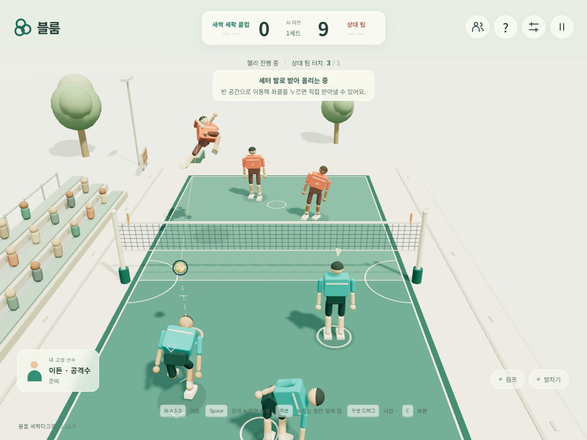
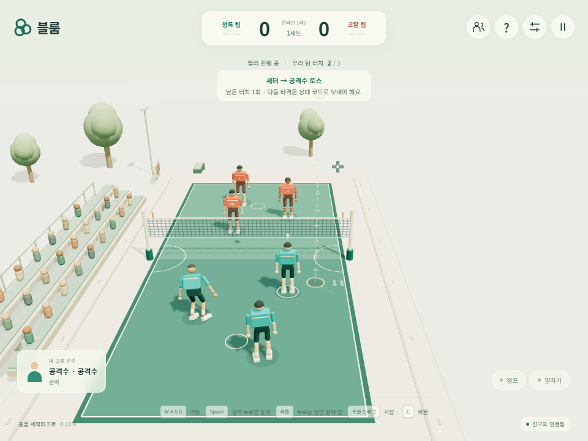

# 일반 서브 수신 연결 성공률

2026-10-26, v0.12.9 Candidate. 기준은 PR #3 머지 후 `e3e97b0612d1d3954abbb8a579dc8d79817d6051`이다. 사용자가 지정한 통과 조건은 일반 서브 수신 후 **리시브 1 → 세트 2 → 스파이크 3으로 네트 통과 80% 이상**이다. 이전 PR의 성공 사례 한 번 관찰은 이 안정성 기준을 충족하는 검증이 아니었다.

## 코드 비교와 원인

첨부 v0.12.6과 최초 저장소의 게임 클래스는 같았다. 물리 클래스의 차이는 체크포인트 직렬화 파이프라인 수명주기였다. PR #1 모듈화와 PR #2 규칙 정렬에서 리시브·AI 물리 동작은 유지됐다. 실제 동작 변경은 PR #3의 배치·이동·발 구동 변경에 집중된다.

PR #3에서 이동 가속·감속 상한을 12에서 5로 낮췄지만 수신 AI의 제동 선행값 0.18초는 유지했다. 공을 따라잡고 멈추는 능력을 동시에 낮춰 타격 지점에 안정적으로 도달하기 어려워졌다. 이번 수정은 **이 상한만 기존 12로 복구**한다. 도달 예측과 실제 힘 제한이 같은 설정을 사용한다. 발 구동·토스 높이·공격수 위치는 유지한다.

가속도만 복구한 경우와 배치만 원복한 경우를 분리한 개발 관찰에서 배치 원복은 개선되지 않았다. 따라서 여러 변수를 한꺼번에 되돌리지 않았다. 함수 호출·AI 빈도·물리 서브스텝은 추가하지 않았으며 성능 향상을 주장하지 않는다.

## 동일 조건의 원인 분리 비교

Chromium에서 각 버전의 실제 게임·Rapier 클래스로 새 인스턴스를 만들고 양팀 AI가 기본 능력치로 자연 진행하는 첫 20개 랠리를 관찰했다. 60Hz·논리틱당 물리 2단계를 유지했다. 이는 빠르게 순차 실행한 내부 진단이며 실제 UI E2E나 실시간 성능 측정과 구별한다. 공 이동·접촉을 주입하거나 서브를 유리한 위치로 재설정하지 않았다.

| 버전 | 첫 수신 접촉 | 두 번째 접촉 | 세 번째 스파이크 | 정상 높이로 네트 통과 |
| --- | ---: | ---: | ---: | ---: |
| 첨부 v0.12.6 | 20/20 | 3/20 | 1/20 | 0/20 |
| PR #3 / v0.12.8 | 20/20 | 20/20 | 20/20 | 13/20 (65%) |
| 가속도 12 복구 | 20/20 | 20/20 | 19/20 | 19/20 (95%) |

단계별 접촉은 별도 집계다. 특히 원본의 일부 접촉은 상대와 공을 주고받은 뒤여서 곧바로 1→2→3 체인 성공을 의미하지 않는다. 성공 사례는 실제 발 스파이크, 리시버·세터·공격수 순서, 터치 1·2·3, 상대편으로 공 중심이 반지름 이상 넘어감, 공 중심이 네트+반지름보다 높음, 코트 폭 안쪽을 확인했다. 역할 순서와 발 부위는 저장된 모든 성공 사례를 추가 확인했다.

원본이 이번 조건에서 더 좋았다는 증거는 없었다. 반면 현재 버전의 65%가 사용자의 기준에 미달하고, 가속도 복구로 95%가 된 사실은 확인했다. 수정 후 실패 1회는 두 번째 토스 이후 아웃이었다. 원시 관찰 기록은 [comparison.json](receive-reliability/comparison.json)에 보존한다.

## 실제 사용자 흐름

영구 E2E는 기존 클럽 저장 → AI 플레이 → 훈련 → 실제 온라인 입장·단절 복구·양쪽 새로고침·퇴장 흐름을 유지한다. AI 플레이에서 두 브라우저가 각각 상대팀의 일반 서브 수신 5회를 관찰한다. 실패하거나 네트 통과 프레임을 놓친 시도도 분모에서 빼지 않는다. 1·2회 toss와 역할 순서, 세 번째 발 스파이크, 정상 높이·폭의 네트 통과를 요구하며 10회 중 8회 이상이어야 통과한다.

두 브라우저는 같은 기본 조건을 반복한다. 이는 5개 랠리 사례를 두 번 실행한 기록이며 서로 다른 10종 서브나 통계적 모집단 성공률 보장은 아니다. 우리 팀 공격수는 무입력으로 두고 상대 AI의 수신 연결을 관찰한다. 사람의 점프·킥 실수까지 자동 보정하는 변경은 없다.

최종 `npm run check`, `npm test` 통과. 두 브라우저 모두 5/5회로 **합계 10/10회(100%)**, 전체 실행은 시작·정리 포함 **123.886초 / 상한 180초**였다. 온라인 다섯 확정 경계의 양쪽 해시도 일치했다. 시간·접촉 순서·실패 목록·소스 SHA-256은 [user-flow.json](receive-reliability/user-flow.json)에 기록했다. 임시 진단 스크립트와 복사한 원본 HTML은 삭제하고 결과만 보존했다.

## 범위

기본 선수·현재 기본 서브 궤적·동일 Windows PC의 Chromium 결과다. 임의 서브 속도·방향, 모든 능력치 조합, 다른 OS·모바일·외부 NAT는 검증하지 않았다. 공개 release/Pages 및 Stable 표시는 변경하지 않는다.
