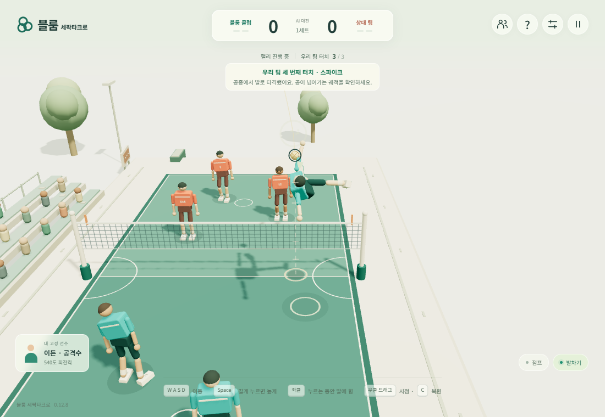
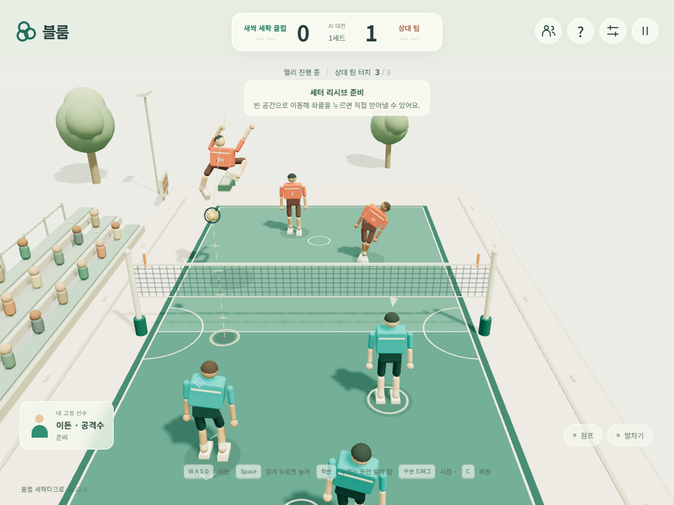

# 리시브 → 세터 → 스파이크 검증

2026-10-25, v0.12.8 Candidate. 기준 main은 PR #2 머지 커밋 `1ef56e699f47ad234a500f2915bf9a26275afa85`다. 공개 release는 변경하지 않았다. 적용 소스 SHA-256과 측정값은 [evidence.json](receive-set-spike/evidence.json)에 보존한다.

## 원인과 변경

기존 45초 브라우저 관찰에서는 6개 랠리, 18회 접촉 중 스파이크가 0회였다. 리시브가 정강이에 걸리거나 바로 상대 코트로 넘어갔고, 공격수는 후방 커버로 이동해 세터의 토스를 놓쳤다. 발끝 접촉점을 기준으로 세운 궤적을 다른 구동점에 적용하던 오차와 과도한 이동 가속도도 자세를 불안정하게 했다.

- 리시브의 공과 몸 사이 간격을 확보하고, 제어된 지상 패스의 궤적·힘 적용 기준을 발목으로 통일했다. 발끝 회전 속도를 고려하고 실제 발 질량·관성으로 접촉 유효 질량을 근사한다. 전체 관절체의 정확한 유효 질량 계산은 아니다.
- 리시브와 세터 토스 높이를 낮추고 접촉 뒤 짧은 후속 동작을 유지한다. 세터는 킥 준비 중에도 이동·감속한다.
- 공격수의 전방 대기 위치와 공중 접촉 예상 지점을 사용한다. 이동 가속도 상한을 도달 예측과 실제 구동에 함께 적용한다.
- 같은 물리 단계에서 변하지 않는 몸체 위치·회전 조회를 공유한다. 물리 서브스텝과 AI 실행 빈도는 늘리지 않았다.

공에 인위적인 충격을 추가하거나 접촉 성공을 주입하지 않는다. Rapier 발 충돌이 실제 패스를 만든다. 플레이어 공격수는 직접 이동·점프·킥해야 한다. 긴급한 1~2회 터치 반환도 유지한다. [공식 경기 안내](https://www.activesgcircle.gov.sg/learn/sepak-takraw/rules-and-regulations-of-sepak-takraw?tab=how_to_play)의 3회는 의무 횟수가 아닌 상한이다. 접촉 관찰은 [Rapier 접촉 이벤트·매니폴드](https://rapier.rs/docs/user_guides/javascript/advanced_collision_detection_js/)를 사용한다.

## 최종 검증

`npm run check` 통과. `npm test`는 실제 Chromium 사용자 흐름 1개를 통과했으며 시작·정리 포함 **56.601초 / 상한 180초**였다. 체크포인트 복원, 실제 Nostr/WebRTC 입장, 양쪽 입력, RTC 단절 후 복구, 참가자·방장 새로고침, 명시적 퇴장을 확인했다. 다섯 확정 경계의 양쪽 상태 해시가 일치했다.

기존 고정 사용자 흐름에 실제 상대 AI의 같은 랠리에서 리시버 → 세터 → 공격수 순서와 네트 통과를 관찰하는 검증을 추가했다. 최종 실행은 tick 703/790/882에서 발로 1/2/3회 접촉했고, 세 번째 스파이크가 상대 코트 `(x=-0.181, y=2.600, z=-1.680)`으로 넘어갔다. 게임 상태를 조작하지 않고 읽기만 한다.

별도 임시 조작 검사에서는 화면에 표시되는 공격 가이드를 읽고 실제 WASD·Space·마우스 입력을 보냈다. tick 339 점프, 345 킥 후 세 번째 발 접촉과 네트 평면 통과를 6.388초에 확인했다. 공 중심은 `(x=0.020, y=3.196, z=1.750)`였다. 자동 점프/공격을 제품 코드에 추가하지 않았다. 실행용 임시 스크립트는 삭제하고 결과만 남겼다.

개발 중 수정안의 45초 관찰은 5개 랠리, 20회 접촉, 3회 스파이크였다. 이 수치는 최종 버전 표기·조회 최적화 전의 개발 관찰이며 최종 사용자 흐름 검증과 구별한다. 매 랠리 성공률을 보장하는 통계는 아니다.

## 별도 비용 측정

동일 PC·Chromium·960×720에서 120틱 준비 후 약 1,200틱씩 순차 측정했다. 대상은 게임 어댑터의 step/view/events 시간으로 렌더링·GPU 전체 시간이 아니다.

| 순서 | 대상 | 평균 ms/틱 | 논리 / 물리 단계 |
| --- | --- | ---: | ---: |
| 1 | 수정안 | 3.596 | 1201 / 2402 |
| 2 | 기준 main | 3.961 | 1201 / 2402 |
| 3 | 기준 main | 4.164 | 1200 / 2400 |
| 4 | 수정안 | 4.087 | 1200 / 2400 |

모두 약 20초에 완료했고 오류가 없었다. 수정안은 실제 패스가 더 연결되어 접촉 수가 다르며, 이 소수 표본으로 보편적 성능 향상을 주장하지 않는다. 기능 성공과 비용 측정을 별도로 기록했다.

## 범위

GameKit 고정 커밋·Three.js·Rapier 버전은 유지했다. Windows 동일 PC의 실제 브라우저 실행 결과다. 모든 선수 능력치 조합, 비상 슬라이딩 전 범위, 모바일·다른 OS·외부 NAT, 전체 경기 종료는 이번 검증에 포함하지 않는다. 공개 배포나 Stable 승격을 의미하지 않는다.
